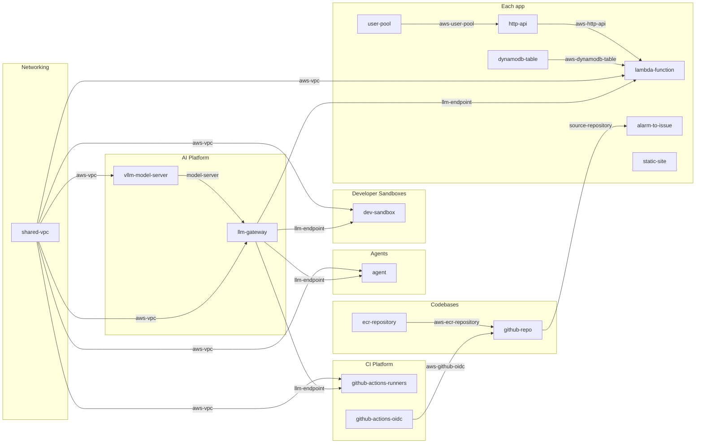

# AWS Software Factory

A Massdriver catalog for running an agentic software factory in your own AWS account. It gives you private models behind one gateway, a disposable VM per developer where coding agents work, GitHub repositories that build container images, the serverless pieces apps run on, agents that work on a schedule, and the automation that turns issues into pull requests and alarms into issues.

Agents never hold cloud credentials. Every infrastructure change goes through Massdriver, under the same policy and approvals as a person.

## Projects

Together these projects are the software factory. Shared foundations are deployed once; per-developer and per-app pieces get an environment each.

| Project | Holds | Environments |
|---|---|---|
| AWS Account (`aws`) | Budget Guard, Cost Reports | One per AWS account, e.g. `workshop` |
| Networking (`networking`) | Shared VPC | One per account and region, e.g. `shared` |
| CI Platform (`ci`) | GitHub Actions OIDC, GitHub Actions Runners (AI review, issue → PR agent) | One per GitHub organization, e.g. `main` |
| AI Platform (`ai`) | LLM Gateway, optional vLLM Model Server | One per AWS account, e.g. `main` |
| Agents (`agents`) | Agents, e.g. an SRE agent and a cost agent | One for the organization, e.g. `main` |
| Codebases (`codebases`) | GitHub Repository, ECR Repository | One per app, named after the app's project, e.g. `todoapp` |
| Developer Sandboxes (`devsandboxes`) | Developer Sandbox | One per developer, e.g. `cory` |
| Each app, e.g. Todo App (`todoapp`) | HTTP API, Lambda Function, DynamoDB Table, User Pool, Static Site, Alarm to Issue | dev, prod, … |

Agents read Massdriver and propose through Massdriver, so one Agents project covers every cloud account the organization manages.

Workloads share the VPC's subnets and are kept apart by their own security groups, so adding a developer or an app never claims address space.

## How bundles connect

Bundles exchange resource types, not internals, so one side can change without the other noticing: moving models from Bedrock to a self-hosted GPU changes the gateway, not the sandboxes, runners, agents or functions that use it.



Arrows between projects are environment defaults, not links: the shared resource is set once on the environment that uses it.

Three credentials sit underneath everything: **AWS IAM Role** (`aws-iam-role`), which every bundle deploys with; **GitHub App** (`github-app`), used by the repository, runner, sandbox, agent and alarm bundles; and **Massdriver Service Account** (`massdriver-service-account`), which lets repositories, sandboxes and agents make their own Massdriver identities. All three are environment defaults, so they're set once per environment instead of linked.

## Bundles

| Bundle | What it is |
|---|---|
| `shared-vpc` | A VPC with public, private and internal subnets in each zone, egress (NAT instance or gateways), endpoints and flow logs |
| `budget-guard` | A monthly spending limit for the account, with alerts on actual and forecast spend |
| `llm-gateway` | One OpenAI-compatible URL in front of Bedrock models and any self-hosted model; per-consumer keys, usage and budgets |
| `vllm-model-server` | An open-weight model on a GPU you run, reachable only through the gateway |
| `dev-sandbox` | A coding-agent VM per developer: opencode (and optionally Claude Code), the gateway, GitHub through the App, Massdriver tools; reached by SSH over Session Manager or in the browser |
| `agent` | A VM that runs a coding agent on a schedule with a prompt you give it, under its own Massdriver identity. Presets for an SRE agent and a cost agent |
| `github-actions-oidc` | Lets GitHub Actions get short-lived AWS credentials. Once per account |
| `github-actions-runners` | Ephemeral self-hosted runners in the VPC's private subnets, with the gateway, plus the AI review and issue → PR agent workflows |
| `github-repo` | A GitHub repository with a write-once starter app and a pipeline that tests, scans and pushes an arm64 image to ECR. Can adopt an existing repository |
| `ecr-repository` | A container image repository with push and pull policies |
| `http-api` | An API Gateway HTTP API; functions attach their own routes. Optional sign-in |
| `lambda-function` | A function behind the API, with an optional table and access to the gateway's models |
| `dynamodb-table` | An on-demand table with read and read-write policies |
| `user-pool` | Cognito sign-in with a hosted page and a browser app client |
| `static-site` | A private S3 bucket behind CloudFront |
| `alarm-to-issue` | Opens a GitHub issue when one of the environment's alarms fires |

Each bundle's README explains its design; its runbook covers what to do when it breaks. Most have presets named for when to use them: **Free Tier** where the defaults stay inside AWS's always-free allowances, **Development** for the cheapest settings that still work well, **Production** for durability and safety.

## Repository layout

```
platforms/        Credential types (AWS IAM Role, GitHub App, Massdriver Service Account)
resource-types/   Contracts between bundles
bundles/          OpenTofu bundles
bootstrap/        The projects, groups and canvases above, from one terraform apply
.github/workflows Publishing
```

## Getting started

1. **Publish from GitHub Actions.** Create a Massdriver service account in a group allowed to publish to the catalog. In the repository's **Settings → Secrets and variables → Actions**, add its key as the secret `MASSDRIVER_API_KEY` and your organization ID as `MASSDRIVER_ORG_ID` (a variable or a secret). Then run **Actions → Publish → Run workflow** with *all* ticked. After that, every push to `main` publishes whatever changed since the last successful publish: credential types and resource types first, then bundles.
2. **Add credentials** in Massdriver: an **AWS IAM Role** and a **GitHub App**, each following the instructions on its form. Share both with every environment.
3. **Build the foundations:** AWS Account, Networking, AI Platform and CI Platform. Then add Agents, Developer Sandboxes, Codebases and apps as people and apps arrive.

## Versioning

Everything publishes as `0.0.0`, which can be republished in place for bundles and resource types alike. Publishing any other version to a repository ends that: once a repository holds a real version, `0.0.0` can no longer be overwritten there.
