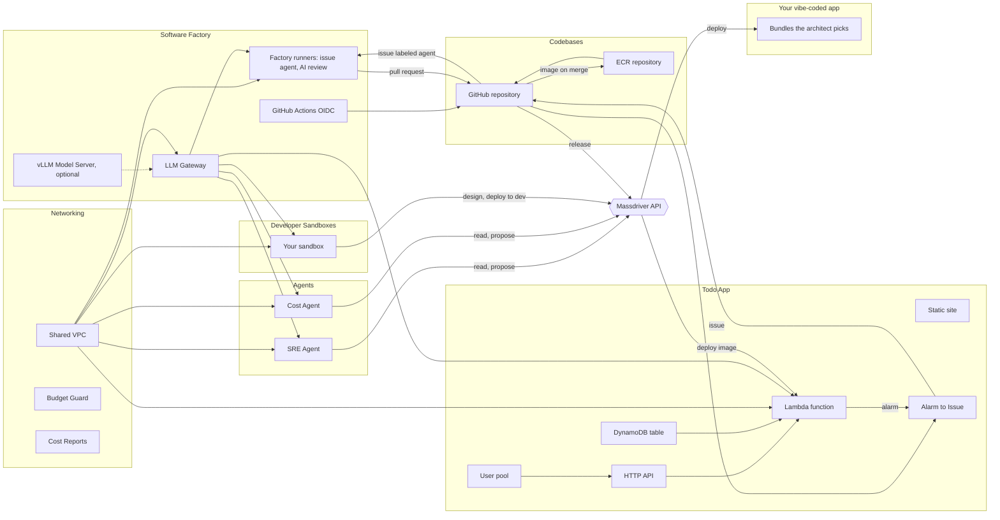

# Workshop notes

Building a Citizen Developer Agentic Software Factory on Self-Hosted Models in Your Own VM Sandbox in Under an Hour

Free workshop paired with the Product Hunt launch of the Massdriver Architect / Context Engine. The catalog in this repo is the product; the workshop is one path through it.

## Scope

Everything runs live; nothing is take-home. The factory is the point of the workshop.

1. **Foundation:** the network, the Software Factory (models, runners), a developer sandbox.
2. **An app:** its codebase (repository and image repository), API, function, table, website and sign-in.
3. **The factory:** an issue that an agent turns into a pull request, CI and AI review on that pull request, a merge that ships a new image, and an alarm that opens the next issue.

Everything before step 10 happens in the browser: GitHub, the AWS Console and Massdriver. The terminal only comes out to work inside the sandbox.

## How it fits together



Each project has a job: **Networking** is the shared VPC; the **Software Factory** serves models and runs CI, review and agents, with one environment per GitHub organization; **Developer Sandboxes** has one environment per person; **Codebases** holds each app's repository and images, with one environment per app; and each **app** has its own project.

## Identities and secrets

Every arrow above runs as one of these. Nothing shares a personal token.

| What | Made by | Lives in | Used by, for | Scope |
|---|---|---|---|---|
| **AWS IAM Role** credential | You, step 3 | Massdriver, default on every environment | Massdriver, to deploy every bundle | Your account, with your External ID |
| **GitHub App** credential | You, step 4 | Massdriver, default where repositories, runners, apps, sandboxes and agents run | The bundles below, to manage repositories and mint short tokens | The repositories the App is installed on |
| **GitHub Actions OIDC** resource | GitHub Actions OIDC bundle, step 6 | An IAM OIDC provider; shared resource | Repository push roles, to trust GitHub's tokens | One per AWS account |
| Push role `<repo>-push` | GitHub Repository bundle | IAM; Actions variables `AWS_ROLE_ARN`, `AWS_REGION`, `ECR_REPOSITORY_URL` | The `build` workflow, to push images | The default branch of that one repository; push to its ECR repository only |
| GitHub App key copy | Runners, Developer Sandbox and Alarm to Issue bundles | Secrets Manager, `<instance>/github-app` | Runners: register and mint agent tokens. Sandbox: `git` and `gh`. Alarm to Issue: open issues | Readable only by that instance's role |
| Agent token | The runners' token function, per job | Memory of one job | `agent.yml`, to push a branch and open a pull request | One repository, `contents`, `pull_requests`, `issues`; only `agent.yml` on issue events; about an hour |
| Gateway master key | LLM Gateway bundle | Secrets Manager, `<gateway>/master-key` | Admin of the gateway | Everything on the gateway |
| Gateway consumer key | Runners, Developer Sandbox and Lambda Function bundles, one each | SSM, under the gateway's key prefix | That consumer, to call models | $20 a month per consumer by default |
| Model server key | vLLM Model Server bundle | Secrets Manager | The gateway, to call your GPU | That model server |
| **Service Account Managers** group | You, step 11 | Massdriver | Holds the identity maker | `manageServiceAccounts`, `manageGroups`: equal to Organization Admin |
| Identity maker and **Massdriver Service Account** credential | You, step 11 | Massdriver, shared with `codebases`, `devsandboxes`, `agents` | Repository, sandbox and agent bundles, to make their own service accounts | Can make an identity in any group. Delete it at teardown |
| **Release to Dev** group | You, step 11 | Massdriver | Release service accounts | `project:view`, `instance:deploy` where `md-environment` is `dev` |
| Release service account `<org>/<repo> release` | GitHub Repository bundle, when **Release to** is set | Token in the Actions secret `MASSDRIVER_API_KEY`; variables `MASSDRIVER_ORGANIZATION_ID`, `MASSDRIVER_URL`, `MASSDRIVER_RELEASE_INSTANCE` | The `release` workflow, to deploy the new image | The groups picked in **Release permissions**; one-year token |
| **Factory Agents** group | You, step 12 | Massdriver | Agent service accounts | `project:view`, `instance:plan`, `instance:propose`; no deploy |
| **Citizen Developers** group | You, step 13 | Massdriver | Your sandbox's service account | Create and design projects, plan and propose anywhere; configure, deploy and decommission only where `md-environment` is `dev` |
| Sandbox service account `<instance> sandbox agents` | Developer Sandbox bundle, for sandboxes and agents, when groups are picked | Secrets Manager, `<instance>/massdriver-api-key` | `mass`, the Massdriver MCP and the agents' goals | The groups picked in **Massdriver access for agents**; one-year token |
| Sandbox access user `<instance>-access` | Developer Sandbox bundle | The **Connect to …** resource; an AWS profile on your laptop after the connect script | `ssh`, to start the VM and open a session | Start that VM and connect as `dev` |
| Browser password | Developer Sandbox bundle | Secrets Manager, `<instance>/browser-password`; printed by the connect script | You, for opencode in the browser and the preview URL | That sandbox |
| Cost collector user | Cost Reports bundle | IAM; keys in Secrets Manager, `<instance>/integration` | Massdriver's cost integration, after you paste them in step 5 | Read the cost report bucket and resource tags |

## Attendee prerequisites (registration email, not day-of)

About 40 minutes, emailed ahead as a separate guide. Nothing gets connected to Massdriver beforehand: a new org has no credential types until the catalog is published to it in step 2.

1. **Massdriver account and organization** (~5 min). Note the org ID.
2. **AWS role for Massdriver** (~10 min). Attendees make up their own External ID, create a role trusting account `308878630280` with that External ID and AdministratorAccess, and note the External ID and the role ARN.
3. **GitHub organization** (~3 min), on the Free plan. GitHub Apps can't create repositories under a personal account.
4. **GitHub App** (~15 min), with the permissions in step 4 below, installed on all repositories. Note the App ID and Installation ID, and keep the `.pem` key safe.
5. *Optional, not recommended for the workshop:* **GPU quota** for the self-hosted model. Request "Running On-Demand G and VT instances" ≥ 4 in us-east-1 a week ahead. Without it, everything runs on Bedrock. The GPU costs ~$0.80 an hour while it runs.
6. *Optional:* **AWS CLI and Session Manager plugin**, for a terminal instead of the browser.

They bring: org ID, role ARN, External ID, GitHub org login, App ID, Installation ID, and the `.pem` file.

## What it costs (us-east-1, on-demand, approximate)

> [!WARNING]
> **Three things cost real money:**
> 1. **The GPU** (step 6, optional): ~$0.80 an hour while it runs. **Skip it for the workshop.**
> 2. **The SRE agent's tokens** (step 12): it runs every 10 minutes, ~$0.75 an hour. Remove the agents after their tests.
> 3. **Anything left running afterwards**: ~$125 a month with no GPU, plus tokens. Do step 14 before you leave.

| Step | Workshop (~3 hours) | A month if left running | What stops it |
|---|---|---|---|
| Optional shortcut: `bootstrap/` + `deploy.sh` (builds steps 5–8, no GPU) | ~$0.15 (~$0.05 an hour) plus tokens | ~$38, the same as steps 5–8 | Nothing; step 14 |
| 5. Networking: VPC, Budget Guard, Cost Reports | ~$0.05 | ~$9 | Nothing; step 14 |
| 6. LLM Gateway | ~$0.06 | ~$14 | Nothing; step 14 |
| 6. GitHub Actions Runners | ~$0.06 | ~$15 | Nothing; step 14 |
| ⚠️ 6. vLLM Model Server (optional, **not recommended**) | ~$2.50–3 | ~$10 stopped, ~$150 on workday hours, ~$600 always on | Idle stop (1 hour), nightly stop (8 pm), step 14 |
| 7. Codebases | ~$0 | Cents | Step 14 |
| 8. Your app | ~$0 | ~$0 at low traffic | Step 14 |
| 9. Your sandbox | ~$0.15 | ~$3 stopped, ~$10 on workday hours | Idle stop (30 minutes), nightly stop (8 pm), step 14 |
| 10–11. opencode and factory agent runs (tokens) | ~$0.50–1.50 | Up to $20 per consumer | The gateway's $20 per consumer per month |
| ⚠️ 12. SRE Agent and Cost Agent VMs | ~$0.25 | ~$62 (always on) | Nothing; remove them after their tests, or step 14 |
| ⚠️ 12. SRE Agent tokens | ~$0.75 an hour | $20, reached in about a day | The gateway's $20 cap; remove the agent |
| 12. Cost Agent tokens | ~$0.15 a run | ~$5 (one run a day) | The gateway's $20 cap |
| ⚠️ 13. Vibe coding (tokens) | ~$1–3 | Up to $20 | The gateway's $20 cap on your sandbox |

| Scenario | Bedrock (default) | Plus your own GPU |
|---|---|---|
| The workshop, agents removed after their tests, then teardown | ~$3–5 | ~$6–8 |
| The workshop with the SRE agent running all 3 hours | ~$7–9 | ~$10–12 |
| A month of solo development, everything auto-stopping, no agents | ~$60–90 | ~$210–240 |
| A month left running 24×7, agents included | ~$125 plus up to $20 of tokens per consumer | ~$725+ |

Where the money goes in a month: the pieces that never stop (VPC ~$9, gateway ~$14, one factory runner ~$15, ~$31 per agent), the sandbox (~$3 stopped, ~$10 on workday hours), and tokens. One agent run on Kimi K2.5 reads ~200,000 tokens: ~$0.10–0.20. The gateway stops each consumer (each sandbox, agent, runner and function) at $20 a month by default. New-account AWS credits cover the workshop.

## Steps

Costs are per month unless noted. Every pick is the cheapest option that doesn't hurt the experience.

### 1. Get the catalog into your GitHub organization

1. Open `github.com/massdriver-catalogs/aws-software-factory` and **Fork** it into your organization (or **Use this template → Create a new repository**).
2. Forks start with Actions turned off. Open the fork's **Actions** tab and click **I understand my workflows, go ahead and enable them**.

### 2. Let GitHub publish the catalog to Massdriver

1. In Massdriver: **Settings → Service Accounts → Create**. Name it `github-publisher` and copy its key; it's shown once.
2. Put it in a group that can publish to the catalog, e.g. **Catalog Publishers**, whose policy allows `repo:create`, `repo:push`, `repo:pull`, `repo:update` and `repo:view` on `*`. **Organization Admin** also works but grants far more.
3. In the fork on GitHub: **Settings → Secrets and variables → Actions**.
   - **Secrets → New repository secret:** `MASSDRIVER_API_KEY` = the key.
   - **Variables → New repository variable:** `MASSDRIVER_ORG_ID` = your Massdriver organization's ID. A secret with that name works too.
4. **Actions → Publish → Run workflow**, tick **all**, **Run workflow**. In a few minutes every credential type, resource type and bundle is in your Massdriver catalog. From now on, every push to `main` publishes what changed.

### 3. Connect AWS (~2 minutes)

The role was created in the prerequisites; now that the catalog is published, Massdriver has the **AWS IAM Role** credential type to put it in.

1. In Massdriver: **Credentials → Add → AWS IAM Role**. Paste the role ARN and your External ID. **Save**.
2. Open the new credential and **Share** it with all environments, so every project can use it as a default.

Bedrock's open-weight models, Kimi included, are enabled by default. Nothing else to turn on.

### 4. Connect GitHub (~2 minutes)

1. In Massdriver: **Credentials → Add → GitHub App**. Fill in your organization's login, the App ID, the Installation ID, and paste the whole `.pem` file into **Private Key**. **Save**.
2. **Share** it with all environments.

*Optional shortcut:* after steps 1–4, in `bootstrap/` run `terraform apply`, then `./deploy.sh --email you@example.com`. It builds steps 5–8 (factory and example app) in about 30 minutes for about $0.05 an hour plus tokens, without the GPU. It needs the GitHub CLI logged in. Paste the Cost Reports values by hand, then continue at step 9.

### 5. Networking

Create project **Networking** (`networking`) with environment **Dev** (`dev`). Set the AWS IAM Role as the environment's credential default.

Add **Shared VPC** with the **Development** preset: two zones, a NAT instance (~$7) and 7-day flow logs. Plus the flow-log encryption key, ~$1. **Shared VPC: ~$8–9.** When it's deployed, **Share** its **network** resource with all environments; every other project runs inside it.

Add **Budget Guard** with the **Free Tier** preset ($25 limit, alerts at 50/80/100% and on forecast), and put your address in **Email alerts to**. **Budget Guard: $0** (the first two budgets in an account are free). Confirm the subscription email AWS sends, or alerts won't arrive.

Add **Cost Reports** with the **Member account** preset (**Management account** if this is the payer account). **Cents.** When it's deployed, open its operator guide, run the command it shows, and paste the four values into **Settings → Integrations → AWS Cost and Usage Reports**. Every instance then shows its cost, usually within a day.

Every bundle has a **Monthly budget (USD)**; each preset fills in one. That's what the cost agent in step 12 checks against.

### 6. Software Factory

Create project **Software Factory** (`factory`) with one environment per GitHub organization and AWS account, e.g. **Main** (`main`). Set the AWS IAM Role, the Shared VPC and the GitHub App as the environment's defaults.

Add **LLM Gateway** with the **Development** preset: Kimi K2.5 (~$0.60 in / $3 out per million tokens), 1-day logs, and a $20 monthly budget per consumer that caps each sandbox, runner and function.

The gateway is a small t4g.small proxy, not a model: it forwards each request to Bedrock or to your own GPU. **Gateway: ~$14 plus tokens.** When it's deployed, **Share** its **endpoint** resource with all environments.

Kimi K3 is stronger, at ~$3.30 / $16.50 per million tokens, but its multi-turn calls through Bedrock can fail on reasoning content, which is how opencode talks. Leave it for later.

Add **GitHub Actions OIDC** with the **New account** preset (**Provider already exists** if the account has one). It exists once per AWS account and lets GitHub Actions push images with no stored AWS keys. **$0.** **Share** its resource with all environments.

Add **GitHub Actions Runners** with the **Development** preset: one Small runner (~$12) with a 30 GB disk (~$2.40). Connect the gateway to the runners on the canvas.

Plus the token function, schedule and secret: under $1. **Runners: ~$15; ~$0.06 for the workshop.** They sit in the VPC's private subnets, take one job each, and reach the gateway with their own key. Jobs never get the VM's AWS role.

> [!WARNING]
> **Optional, and not recommended for the workshop.** The GPU costs ~$0.80 an hour while it runs (~$3 for the workshop) and ~$600 a month if it never stops. Everything in the workshop works on Bedrock without it. Add it only if you mean to, and tear it down after.

Optional, the "your own model" moment (needs G/VT quota): add **vLLM Model Server** with the **Development** preset (g6.xlarge with gpt-oss-20b, ~$0.80 per hour running, stops after an hour idle and at 8 pm), set **Time zone for the nightly stop** to yours, and connect it to the gateway on the canvas.

Stopped, it costs its disk and key, ~$10. **A 3-hour workshop: ~$3.** It answers about 10 minutes after its deploy finishes, so deploy it before the sandbox. Once connected, the gateway also serves `self-hosted-gpt-oss-20b`.

### 7. Codebases

Create project **Codebases** (`codebases`) with one environment per app, e.g. **Todo App** (`todoapp`). Set the AWS IAM Role, the GitHub App and the GitHub Actions OIDC resource as the environment's defaults.

Add **ECR Repository** with the **Development** preset (immutable tags, scan on push, keep 10 images: pennies), and **GitHub Repository** with the **Private app** preset (repository `todoapp`). Connect the ECR Repository to the GitHub Repository.

The repository arrives with a starter app and a pipeline: every pull request runs tests, a secret scan, an arm64 image build and an image scan; every push to `main` also pushes the image to ECR, tagged with the commit. It also gets the factory workflows (the issue agent and AI review) and an `agent` label, which run on the Software Factory's runners. Starter files are written once and then belong to the team; redeploys never overwrite them. **Codebases: ~$0** (a private build uses a few of the free plan's 2,000 Actions minutes). When it's deployed, **Share** the repository's resource with all environments.

Watch the first build under the repository's **Actions** tab. When it's green, the image URI is in ECR: `<account>.dkr.ecr.us-east-1.amazonaws.com/codebases-todoapp-ecr:<commit>`.

### 8. Your app

Create a project named after the app, e.g. **Todo App** (`todoapp`), with environment **Dev** (`dev`). Set the AWS IAM Role, the Shared VPC, the LLM Gateway's endpoint and the GitHub App as the environment's defaults.

Add these, then connect the API and the table to the function:

| Bundle | Preset | Then change | Cost |
|---|---|---|---|
| Static Site | Single-page app | — | $0 in CloudFront's free tier |
| HTTP API | Development | — | ~$1 per million requests |
| DynamoDB Table | Development | — | ~$1.25 per million writes, $0.25 per million reads |
| Lambda Function | Free Tier | **Container image**: the image URI from step 7 | $0 in Lambda's free tier |

With the environment's LLM endpoint default set, the function also runs inside the VPC with its own gateway key, and gets `OPENAI_BASE_URL`, `OPENAI_API_KEY` and `OPENAI_MODEL`. **App: effectively $0** at workshop traffic; the free tiers cover it.

Open the HTTP API's endpoint in a browser: the app answers.

Now add sign-in. Add **User Pool** (**Users**) with the **Free Tier** preset, set **Where to return after sign-in** to the Static Site's URL with its trailing slash, and connect it to the **HTTP API**. **$0** (free for the first 10,000 monthly users). Until now the function's routes have been public: **Require sign-in** is on in its preset, but there was no user pool yet, and its deploy log said so. Redeploy the HTTP API, then redeploy the function. The endpoint now answers `401` without a signed-in user's token.

Add **Alarm to Issue** with the **Issues only** preset and turn on **Send a test alarm on this deploy** for the first deploy only. Point its **repository** at the Codebases repository with a remote reference. **$0.** The test deploy opens an `Alarm: …` issue in the repository, with links to the alarm and the Massdriver project, environment and instance it came from.

### 9. Your sandbox

Create project **Developer Sandboxes** (`devsandboxes`) with an environment named after you, e.g. `cory`. Set the AWS IAM Role, the Shared VPC, the LLM Gateway's endpoint and the GitHub App as the environment's defaults.

Add **Developer Sandbox** with the **In the browser** preset: a Light ARM VM (~$0.03 per hour running), a 20 GB workspace (~$1.60), private network, browser access ($0 in CloudFront's free tier), opencode, and stops after 30 idle minutes and at 8 pm. Set **Timezone** and your name and email for commits.

Plus the system disk (~$1.30) and the idle alarm (~$0.10). **Sandbox: ~$3 stopped, ~$10 on workday hours. A 3-hour workshop: ~$0.15.** The first deploy with browser access takes about 15 minutes while CloudFront connects to the VM.

Private mode means no public address (saving ~$4 a month) and nothing on the internet can reach the VM; CloudFront reaches it privately. The sandbox can clone and push your organization's repositories through the GitHub App, with no personal token.

### 10. Shell in

This is the first time you need a terminal.

1. In Massdriver, open the sandbox's **Connect to …** resource and click **Connect script**. It downloads a `.sh` file.
2. Install the AWS CLI and the Session Manager plugin. Homebrew's cask for the plugin is disabled, so it comes from AWS:

   ```bash
   brew install awscli
   curl -fsSLo /tmp/smp.zip "https://s3.amazonaws.com/session-manager-downloads/plugin/latest/$([ "$(uname -m)" = arm64 ] && echo mac_arm64 || echo mac)/sessionmanager-bundle.zip"
   unzip -qo /tmp/smp.zip -d /tmp
   sudo /tmp/sessionmanager-bundle/install -i /usr/local/sessionmanagerplugin -b /usr/local/bin/session-manager-plugin
   ```

3. `sh ~/Downloads/<connect script>`. It sets up an AWS profile and an SSH host for this sandbox only, and prints the browser URLs with their username and password.
4. Either open the **opencode** URL in the browser, or `ssh devsandboxes-<you>-sandbox` and run `opencode`. If the sandbox has stopped itself, `ssh` starts it; give it a minute.

Inside, `git clone https://github.com/<your-org>/todoapp` works with no login. opencode starts on Kimi K2.5; `/models` switches to Kimi K3 or, if you added the GPU, `self-hosted-gpt-oss-20b`.

### 11. The factory, live

All in the browser again.

1. **Check the agents are there.** The `todoapp` repository already has `.github/workflows/agent.yml`, `.github/workflows/ai-review.yml` and an `agent` label, from **Add the factory workflows** in step 7.
2. **Issue → pull request.** Open an issue, e.g. "Add a `/health` route that returns `{"ok": true}`, with a test", and label it `agent`. Within a few minutes the agent comments, then opens a pull request from `agent/issue-N`.
3. **CI and review run on it.** The tests, secret scan, build and image scan run, and the gateway's model posts a review. If the review has a point, comment `/agent` with it, and the agent updates the same pull request.
4. **Turn on release to dev.** Merged code should reach dev without anyone touching Massdriver. The repository gets its own Massdriver identity for that, made by a credential that can make identities.
   - **Groups.** **Settings → Groups**: **Service Account Managers** allows `organization:manageServiceAccounts` and `organization:manageGroups` on `*`. **Release to Dev** allows `project:view` and `instance:deploy` where `md-environment` is `dev`.
   - **The identity maker.** **Settings → Service Accounts → Create** one, e.g. `Service Account Creator`, copy its token, and add it to **Service Account Managers**. Then **Credentials → Add → Massdriver Service Account** with your organization ID and that token. **Share** it only with the projects `codebases`, `devsandboxes` and `agents`: whoever holds it can make an identity in any group. Set it as a default on **Codebases / Todo App**.
   - **The repository.** On the **GitHub Repository**, set **Release to** to the Lambda Function's instance ID, e.g. `todoapp-dev-fn`, pick **Release to Dev** in **Release permissions**, and deploy. The repository gets a `release` workflow and a service account in that group only.
5. **Merge it.** The push to `main` builds a new image and pushes it to ECR. When the build is green, the `release` workflow deploys it to the Lambda Function in dev. Watch the deployment appear on the Lambda Function in Massdriver with the message `Release <commit>`. That deployment is the proof: every route, `/health` included, answers `401` without a signed-in user's token.
6. **Close the loop.** On **Alarm to Issue**, turn **Hand alarms to the agent** on and deploy. From now on, when one of the app's alarms fires, an issue opens with the `agent` label, the agent proposes a fix, CI and review run, and a person decides whether to merge.

Each agent run costs ~$0.10–0.50 in tokens on Kimi K2.5, charged to the runners' gateway key.

### 12. Agents that run themselves

> [!WARNING]
> **The agents never stop on their own.** Each agent's VM stays up for its schedule: ~$31 a month each. The SRE agent also reads ~200,000 tokens every 10 minutes: **~$0.75 an hour**, until the gateway stops it at $20 for the month, about a day later. Run the tests in this step, then remove both agents (item 7).

The sandbox from step 9 can also be a home for an agent nobody is driving. The **SRE Agent** and **Cost Agent** are that sandbox with a goal, a schedule, and their own Massdriver identity. They read everything through Massdriver, hold no cloud credentials, and only ever propose.

1. **A group for agents.** **Settings → Groups → Factory Agents**: allow `project:view`, `instance:plan` and `instance:propose` on `*`. No `instance:deploy`, so a person approves every change.
2. **The identity maker** from step 11 makes the agents' identities too.
3. **The project.** Create **Agents** (`agents`) with environment **Main** (`main`). Set the AWS IAM Role, the Shared VPC, the LLM Gateway's endpoint, the GitHub App and the Massdriver Service Account as its defaults.
4. **The agents.** Add **SRE Agent** and **Cost Agent**, each with the **Lowest cost** preset, and pick **Factory Agents** in **Massdriver access for agents**. Each deploy creates a service account for that agent, in that group only. **~$31 each a month**, because a repeating goal keeps the VM up; **~$0.04 an hour each.** Tokens come on top: ~$1.50 an hour for the SRE agent, ~$0.15 a run for the cost agent. The gateway stops each agent at $20 a month.
   - The SRE agent checks Massdriver's alarms every 10 minutes.
   - The cost agent checks every instance's cost against its budget once a day.
5. **Watch one work.** Shell in to the Cost Agent the same way as step 10, with its **Connect script**, and run:

   ```bash
   sandbox-goal --test
   ```

   Cost data takes a day, so the test pretends one instance costs 3 times its budget. Everything else is real. It finds a cheaper config, runs a plan marked **💸 [test]**, and proposes the change with a **💸 [test]** message. Open the instance in Massdriver to see the plan and the pending proposal. Reject it.
6. **The SRE agent's test.** Shell in to the SRE Agent and run `sandbox-goal --test`. It pretends one of the app's alarms is firing, digs into the instance, and proposes a fix or opens a draft pull request, marked **🚨 [test]**. Reject or close it.
7. **Remove them.** On the **Agents** canvas, decommission **SRE Agent** and **Cost Agent**. This stops their VMs and their tokens. Their service accounts are deleted with them. Deploy them again whenever you want them back.

Their journals are in `/workspace/sre/journal.md` and `/workspace/cost/journal.md`; every run's output is in `/workspace/.goal/runs`. Copy anything you want to keep before item 7.

### 13. Vibe code an app

You are a citizen developer now. You describe an app; the agent in your sandbox designs its infrastructure in Massdriver, writes the code, and ships it to dev. Anything outside dev, it can only propose.

> [!WARNING]
> **A long agent session reads a few million tokens: ~$1–3 on Kimi K2.5.** It's charged to your sandbox's gateway key, which stops at $20 a month. The app it builds runs in its free tiers, like step 8.

1. **A group for builders.** **Settings → Groups → Citizen Developers**, with two policies:
   - Allow `project:create`, `project:view`, `project:design`, `environment:create`, `repo:view`, `resource:view`, `instance:plan` and `instance:propose` on `*`.
   - Allow `environment:configure`, `instance:configure`, `instance:deploy` and `instance:decommission` where `md-environment` is `dev`.
2. **Give your sandbox that identity.** Set the **Massdriver Service Account** credential as a default on your **Developer Sandboxes** environment. On your sandbox from step 9, pick **Citizen Developers** in **Massdriver access for agents** and deploy. The sandbox gets its own service account, in that group only.
3. **A home for the code.** In **Codebases**, add an environment for the new app, e.g. **Notes** (`notes`), with the same defaults as **Todo App** plus the Massdriver Service Account. Add **ECR Repository** and **GitHub Repository** (repository `notes`) the same way as step 7, and connect them.
4. **A project for the app.** Create **Notes** (`notes`) with environment **Dev** (`dev`). Set the AWS IAM Role, the Shared VPC, the LLM Gateway's endpoint and the GitHub App as its defaults. Leave the canvas empty.
5. **Vibe code it.** Shell in to your sandbox as in step 10, `git clone https://github.com/<your-org>/notes`, `cd notes`, and run `opencode`. Tell it what you want, e.g. "A notes app with sign-in. Use the Massdriver architect to design its infrastructure in the `notes` project, deploy it to dev, then write the app in this repository and open a pull request." Steer it as it goes.
6. **Ship it.** The architect adds bundles to the **Notes** canvas and deploys them to dev; watch them appear. When the function exists, set **Release to** on the `notes` repository to its instance ID with **Release to Dev** picked, as in step 11. Merge the pull request, and the `release` workflow ships it.

The sandbox runs as you designed it: it can build and deploy in dev, and nothing else. Try asking it to deploy to production; it can only propose.

### 14. Tear it down

> [!WARNING]
> **Tear everything down before you leave.** Stopped machines still bill for their disks, including a stopped GPU (~$10 a month). The gateway, NAT instance and factory runner never stop on their own (~$38 a month together), and neither do the agents (~$31 a month each, plus tokens). Decommissioning deletes everything, disks included.

Decommission each environment in this order; the shared pieces go last because everything else runs on them:

1. **Agents** (`main`). Their service accounts are deleted with them.
2. **Your apps** (`todoapp` / `dev` and `notes` / `dev`)
3. **Developer Sandboxes** (your environment). Anything in `/workspace` that isn't pushed to git is gone.
4. **Codebases** (`todoapp` and `notes`). The GitHub repository is archived, not deleted; its images are deleted.
5. **Software Factory** (`main`): the gateway, the runners, and the GPU if you added it.
6. **Networking** (`dev`): the VPC and its NAT instance, Budget Guard and Cost Reports. Then remove the **AWS Cost and Usage Reports** integration in **Settings → Integrations**; its bucket is gone.

Then delete the IAM role from step 3 and the GitHub App from step 4 if you won't use them again. In Massdriver, delete the identity maker's service account and credential; it can make an identity in any group.

## Messaging

- The default model, Kimi K2.5 on Bedrock, is a strong coding agent at pennies a run. Your own GPU with gpt-oss-20b is the "your model, your hardware" option: it works, it's private, and it's weaker than Kimi. Switching is one setting, and the sandbox never changes.
- The agent never holds cloud credentials. Infrastructure changes go through Massdriver, and code changes go through pull requests a person merges.
- "Issue → agent PR → review → merge → deploy to dev" is the closing demo. Alarms open issues the same way.
