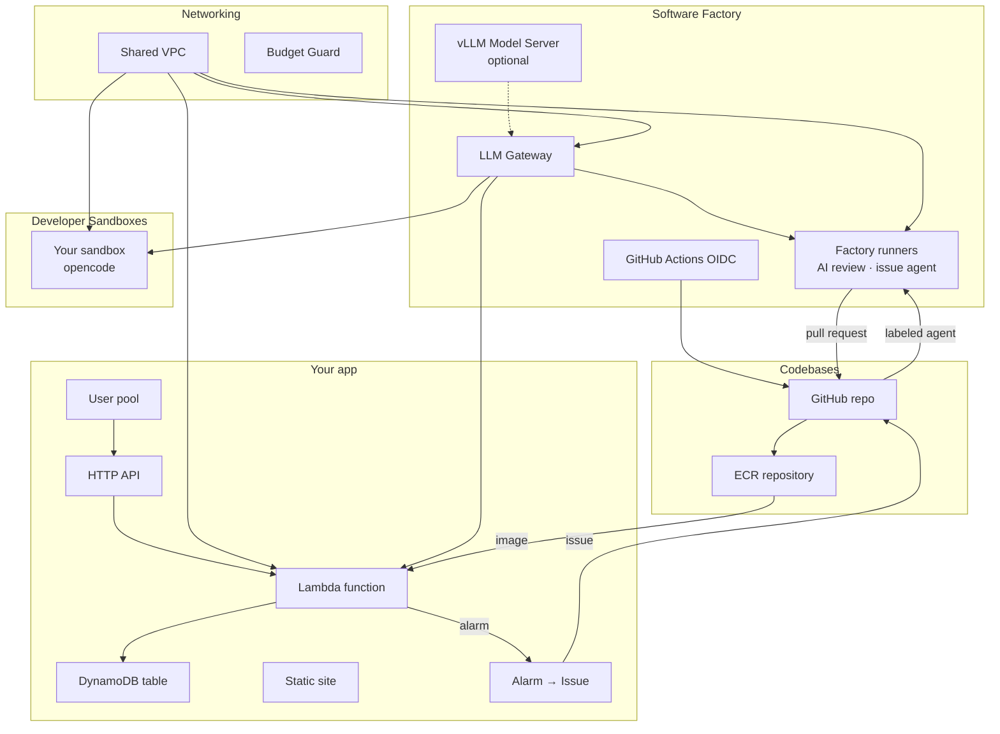

# Workshop notes

Building a Citizen Developer Agentic Software Factory on Self-Hosted Models in Your Own VM Sandbox in Under an Hour

Free workshop paired with the Product Hunt launch of the Massdriver Architect / Context Engine. The catalog in this repo is the product; the workshop is one path through it.

## Scope

Everything runs live; nothing is take-home. The factory is the point of the workshop.

1. **Foundation:** the network, the Software Factory (models, runners), a developer sandbox.
2. **An app:** its codebase (repository and image repository), API, function, table, website and sign-in.
3. **The factory:** an issue that an agent turns into a pull request, CI and AI review on that pull request, a merge that ships a new image, and an alarm that opens the next issue.

Everything before step 10 happens in the browser: GitHub, the AWS Console and Massdriver. The terminal only comes out to work inside the sandbox.

## How it fits together



Each project has a job: **Networking** is the shared VPC; the **Software Factory** serves models and runs CI, review and agents, with one environment per GitHub organization; **Developer Sandboxes** has one environment per person; **Codebases** holds each app's repository and images, with one environment per app; and each **app** has its own project.

## Attendee prerequisites (registration email, not day-of)

- **AWS account.** For the optional self-hosted GPU, request "Running On-Demand G and VT instances" quota of 4+ vCPUs about a week ahead; new accounts often start at 0. Without it, the workshop runs on Bedrock only, which is the default anyway.
- **Massdriver account.**
- **GitHub organization.** A free one is fine. GitHub Apps can't create repositories under a personal account.

## Cost talking points (us-east-1, on-demand, approximate)

| Scenario | Bedrock (default) | Plus your own GPU |
|---|---|---|
| The workshop (~3 hours, then teardown) | ~$2–3 | ~$5–6 |
| A month of solo development, everything auto-stopping | ~$65–85 | ~$205–225 |
| A month left running 24×7 | ~$95–115 | ~$690+ |

Where the money goes in a month: the platform pieces that never stop (VPC ~$9, gateway ~$14, one factory runner ~$15), the sandbox (~$3 stopped, ~$10 on workday hours), and tokens (a few cents per agent run on Kimi K2.5; the gateway caps each consumer at $20 a month by default). New-account AWS credits cover the workshop. Forgetting a GPU is the main risk; idle stop, nightly stop and the budget alert exist for it.

## Steps

Costs are per month unless noted. Every pick is the cheapest option that doesn't hurt the experience.

### 1. Get the catalog into your GitHub organization

1. Open `github.com/massdriver-catalogs/aws-software-factory` and **Fork** it into your organization (or **Use this template → Create a new repository**).
2. Forks start with Actions turned off. Open the fork's **Actions** tab and click **I understand my workflows, go ahead and enable them**.

### 2. Let GitHub publish the catalog to Massdriver

1. In Massdriver: **Settings → Service Accounts → Create**. Name it `github-publisher` and copy its key; it's shown once.
2. Put it in a group that can publish to the catalog: a group whose policy allows `repo:create`, `repo:push`, `repo:pull`, `repo:update` and `repo:view`. **Organization Admin** also works but grants far more.
3. In the fork on GitHub: **Settings → Secrets and variables → Actions**.
   - **Secrets → New repository secret:** `MASSDRIVER_API_KEY` = the key.
   - **Variables → New repository variable:** `MASSDRIVER_ORG_ID` = your Massdriver organization's ID. A secret with that name works too.
4. **Actions → Publish → Run workflow**, tick **all**, **Run workflow**. In a few minutes every credential type, resource type and bundle is in your Massdriver catalog. From now on, every push to `main` publishes what changed.

### 3. Connect AWS (~5 minutes)

Massdriver deploys into your account by assuming a role you create. The role trusts Massdriver's AWS account only when your organization's external ID is presented.

1. In Massdriver: **Credentials → Add → AWS IAM Role**. Keep this tab open; the instructions on it show your **External ID**.
2. In the AWS Console: **IAM → Roles → Create role**.
3. Choose **AWS account → Another AWS account** and enter `308878630280`.
4. Tick **Require external ID** and paste the External ID from step 1. **Next**.
5. Search for and tick **AdministratorAccess**. The catalog creates networks, IAM roles, GPU instances and model endpoints. **Next**.
6. Name the role `massdriver` and **Create role**.
7. Open the role, copy its **ARN** from the top of the page, and paste it and the External ID into the Massdriver form. **Save**.
8. Open the new credential and **Share** it with all environments, so every project can use it as a default.

Bedrock's open-weight models, Kimi included, are enabled by default. Nothing else to turn on.

### 4. Connect GitHub (~10 minutes)

Massdriver creates repositories, workflows and runners through a GitHub App on your organization. The app's tokens expire within an hour, and it acts as a bot, not as you.

1. Go to **github.com/organizations/<your-org>/settings/apps/new**.
2. **GitHub App name:** `<your-org>-massdriver`. **Homepage URL:** your organization's GitHub URL. Under **Webhook**, untick **Active**.
3. **Repository permissions**, all **Read and write**: Actions, Administration, Contents, Issues, Pull requests, Secrets, Variables, Workflows. Metadata becomes Read-only on its own.
4. **Organization permissions:** Self-hosted runners → **Read and write**.
5. **Where can this GitHub App be installed?** → **Only on this account**. **Create GitHub App**.
6. On the app's page, copy the **App ID**.
7. In the app's sidebar, **Credentials → Key pairs → New key**. A `.pem` file downloads.
8. **Install App** in the sidebar → your organization → **All repositories** → **Install**. The URL ends in `/installations/<number>`: that number is the **Installation ID**.
9. In Massdriver: **Credentials → Add → GitHub App**. Fill in your organization's login, the App ID, the Installation ID, and the whole contents of the `.pem` file. **Save**, then **Share** it with all environments.

If the **Private Key** box won't take the multi-line key, create the credential from a terminal instead:

```bash
jq -n --rawfile key ~/Downloads/<app>.private-key.pem \
  '{owner: "<your-org>", app_id: "<app-id>", installation_id: "<installation-id>", private_key: $key}' > /tmp/github-app.json \
  && mass resource create -n github-app -t github-app -f /tmp/github-app.json; rm -f /tmp/github-app.json
```

### 5. Networking

Create project **Networking** (`networking`) with environment **Dev** (`dev`). Set the AWS IAM Role as the environment's credential default.

Add **Shared VPC** with the **Development** preset: two zones, a NAT instance (~$7) and 7-day flow logs. Plus the flow-log encryption key, ~$1. **Shared VPC: ~$8–9.** When it's deployed, **Share** its **network** resource with all environments; every other project runs inside it.

Add **Budget Guard** with the **Free Tier** preset ($25 limit, alerts at 50/80/100% and on forecast), and put your address in **Email alerts to**. **Budget Guard: $0** (the first two budgets in an account are free). Confirm the subscription email AWS sends, or alerts won't arrive.

### 6. Software Factory

Create project **Software Factory** (`factory`) with one environment per GitHub organization and AWS account, e.g. **Main** (`main`). Set the AWS IAM Role, the Shared VPC and the GitHub App as the environment's defaults.

Add **LLM Gateway** with the **Development** preset: Kimi K2.5 (~$0.60 in / $3 out per million tokens), 1-day logs, and a $20 monthly budget per consumer that caps each sandbox, runner and function.

The gateway is a small t4g.small proxy, not a model: it forwards each request to Bedrock or to your own GPU. **Gateway: ~$14 plus tokens.** When it's deployed, **Share** its **endpoint** resource with all environments.

Kimi K3 is stronger, at ~$3.30 / $16.50 per million tokens, but its multi-turn calls through Bedrock can fail on reasoning content, which is how opencode talks. Leave it for later.

Add **GitHub Actions OIDC**. It exists once per AWS account and lets GitHub Actions push images with no stored AWS keys. If the account already has one, turn on **Adopt the existing provider**. **$0.** **Share** its resource with all environments.

Add **GitHub Actions Runners** with the **Development** preset: one Small runner (~$12) with a 30 GB disk (~$2.40). Connect the gateway to the runners on the canvas.

Plus the token function, schedule and secret: under $1. **Runners: ~$15; ~$0.06 for the workshop.** They sit in the VPC's private subnets, take one job each, and reach the gateway with their own key. Jobs never get the VM's AWS role.

Optional, the "your own model" moment (needs G/VT quota): add **vLLM Model Server** with the **Development** preset (g6.xlarge with gpt-oss-20b, ~$0.80 per hour running, stops after an hour idle and at 8 pm), set **Time zone for the nightly stop** to yours, and connect it to the gateway on the canvas.

Stopped, it costs its disk and key, ~$10. **A 3-hour workshop: ~$3.** It answers about 10 minutes after its deploy finishes, so deploy it before the sandbox. Once connected, the gateway also serves `self-hosted-gpt-oss-20b`.

### 7. Codebases

Create project **Codebases** (`codebases`) with one environment per app, e.g. **Todo App** (`todoapp`). Set the AWS IAM Role, the GitHub App and the GitHub Actions OIDC resource as the environment's defaults.

Add **ECR Repository** with the **Development** preset (immutable tags, scan on push, keep 10 images: pennies), and **GitHub Repository** with the **Private app** preset (repository `todoapp`). Connect the ECR Repository to the GitHub Repository.

The repository arrives with a starter app and a pipeline: every pull request runs tests, a secret scan, an arm64 image build and an image scan; every push to `main` also pushes the image to ECR, tagged with the commit. It also gets the factory workflows (the issue agent and AI review) and an `agent` label, which run on the Software Factory's runners. Starter files are written once and then belong to the team; redeploys never overwrite them. **Codebases: ~$0** (a private build uses a few of the free plan's 2,000 Actions minutes). When it's deployed, **Share** the repository's resource with all environments.

Watch the first build under the repository's **Actions** tab. When it's green, the image URI is in ECR: `<account>.dkr.ecr.us-east-1.amazonaws.com/codebases-todoapp-ecr:<commit>`.

### 8. Your app

Create a project named after the app, e.g. **Todo App** (`todoapp`), with environment **Dev** (`dev`). Set the AWS IAM Role, the Shared VPC, the LLM Gateway's endpoint and the GitHub App as the environment's defaults.

Add these, then connect the API and the table to the function:

| Bundle | Preset | Then change | Cost |
|---|---|---|---|
| Static Site | Single-page app | — | $0 in CloudFront's free tier |
| HTTP API | Development | — | ~$1 per million requests |
| DynamoDB Table | Development | — | ~$1.25 per million writes, $0.25 per million reads |
| Lambda Function | Free Tier | **Container image**: the image URI from step 7 | $0 in Lambda's free tier |

With the environment's LLM endpoint default set, the function also runs inside the VPC with its own gateway key, and gets `OPENAI_BASE_URL`, `OPENAI_API_KEY` and `OPENAI_MODEL`. **App: effectively $0** at workshop traffic; the free tiers cover it.

Open the HTTP API's endpoint in a browser: the app answers.

Now add sign-in. Add **User Pool** (**Users**) with the **Free Tier** preset, set **Where to return after sign-in** to the Static Site's URL with its trailing slash, and connect it to the **HTTP API**. **$0** (free for the first 10,000 monthly users). Until now the function's routes have been public: **Require sign-in** is on in its preset, but there was no user pool yet, and its deploy log said so. Redeploy the HTTP API, then redeploy the function. The endpoint now answers `401` without a signed-in user's token.

Add **Alarm to Issue** with the **Issues only** preset and turn on **Send a test alarm on this deploy** for the first deploy only. Point its **repository** at the Codebases repository with a remote reference. **$0.** The test deploy opens an `Alarm: …` issue in the repository, with links to the alarm and the Massdriver project, environment and instance it came from.

### 9. Your sandbox

Create project **Developer Sandboxes** (`devsandboxes`) with an environment named after you, e.g. `cory`. Set the AWS IAM Role, the Shared VPC, the LLM Gateway's endpoint and the GitHub App as the environment's defaults.

Add **Developer Sandbox** with the **In the browser** preset: a Light ARM VM (~$0.03 per hour running), a 20 GB workspace (~$1.60), private network, browser access ($0 in CloudFront's free tier), opencode, and stops after 30 idle minutes and at 8 pm. Set **Timezone** and your name and email for commits.

Plus the system disk (~$1.30) and the idle alarm (~$0.10). **Sandbox: ~$3 stopped, ~$10 on workday hours. A 3-hour workshop: ~$0.15.** The first deploy with browser access takes about 15 minutes while CloudFront connects to the VM.

Private mode means no public address (saving ~$4 a month) and nothing on the internet can reach the VM; CloudFront reaches it privately. The sandbox can clone and push your organization's repositories through the GitHub App, with no personal token.

### 10. Shell in

This is the first time you need a terminal.

1. In Massdriver, open the sandbox's **Connect to …** resource and click **Connect script**. It downloads a `.sh` file.
2. Install the AWS CLI and the Session Manager plugin. Homebrew's cask for the plugin is disabled, so it comes from AWS:

   ```bash
   brew install awscli
   curl -fsSLo /tmp/smp.zip "https://s3.amazonaws.com/session-manager-downloads/plugin/latest/$([ "$(uname -m)" = arm64 ] && echo mac_arm64 || echo mac)/sessionmanager-bundle.zip"
   unzip -qo /tmp/smp.zip -d /tmp
   sudo /tmp/sessionmanager-bundle/install -i /usr/local/sessionmanagerplugin -b /usr/local/bin/session-manager-plugin
   ```

3. `sh ~/Downloads/<connect script>`. It sets up an AWS profile and an SSH host for this sandbox only, and prints the browser URLs with their username and password.
4. Either open the **opencode** URL in the browser, or `ssh devsandboxes-<you>-sandbox` and run `opencode`. If the sandbox has stopped itself, `ssh` starts it; give it a minute.

Inside, `git clone https://github.com/<your-org>/todoapp` works with no login. opencode starts on Kimi K2.5; `/models` switches to Kimi K3 or, if you added the GPU, `self-hosted-gpt-oss-20b`.

### 11. The factory, live

All in the browser again.

1. **Check the agents are there.** The `todoapp` repository already has `.github/workflows/agent.yml`, `.github/workflows/ai-review.yml` and an `agent` label, from **Add the factory workflows** in step 7.
2. **Issue → pull request.** Open an issue, e.g. "Add a `/health` route that returns `{"ok": true}`, with a test", and label it `agent`. Within a few minutes the agent comments, then opens a pull request from `agent/issue-N`.
3. **CI and review run on it.** The tests, secret scan, build and image scan run, and the gateway's model posts a review. If the review has a point, comment `/agent` with it, and the agent updates the same pull request.
4. **Merge it.** The push to `main` builds a new image and pushes it to ECR, tagged with the commit.
5. **Ship it.** On the app's **Lambda Function**, set **Container image** to the new tag and deploy. Release to dev isn't automated yet; for now this one field is the release.
6. **Close the loop.** On **Alarm to Issue**, turn **Hand alarms to the agent** on and deploy. From now on, when one of the app's alarms fires, an issue opens with the `agent` label, the agent proposes a fix, CI and review run, and a person decides whether to merge.

Each agent run costs a few cents in tokens on Kimi K2.5.

### 12. Tear it down

> [!WARNING]
> **Tear everything down before you leave.** Stopped machines still bill for their disks, and the gateway, NAT instance and factory runner never stop on their own (~$36/month together). Decommissioning deletes everything, disks included.

Decommission each environment in this order; the shared pieces go last because everything else runs on them:

1. **Your app** (`todoapp` / `dev`)
2. **Developer Sandboxes** (your environment). Anything in `/workspace` that isn't pushed to git is gone.
3. **Codebases** (`todoapp`). The GitHub repository is archived, not deleted; its images are deleted.
4. **Software Factory** (`main`)
5. **Networking** (`dev`)

Then delete the IAM role from step 3 and the GitHub App from step 4 if you won't use them again.

## Messaging

- The default model, Kimi K2.5 on Bedrock, is a strong coding agent at pennies a run. Your own GPU with gpt-oss-20b is the "your model, your hardware" option: it works, it's private, and it's weaker than Kimi. Switching is one setting, and the sandbox never changes.
- The agent never holds cloud credentials. Infrastructure changes go through Massdriver, and code changes go through pull requests a person merges.
- "Production alarm → issue → agent PR → review → merge → deploy" is the closing demo.
