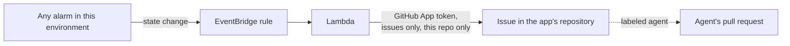

# Alarm to Issue

When an alarm in this environment fires, a GitHub issue appears in the app's repository with what fired, why, and where to look. That closes the loop from production back to planning: the issue can go to a person, or straight to the issue agent.

## What it catches

Every CloudWatch alarm whose name starts with this environment's `<project>-<environment>-`, which is every alarm the catalog's bundles create here. Nothing else needs connecting or changing; new components' alarms are picked up as they appear.

## What it does

- **Alarm fires:** opens an issue titled `Alarm: <alarm name>`, labeled `alarm`, with the reason, the metric, links to the alarm and (for functions) their logs, and the Massdriver project, environment and instance it belongs to.
- **Fires again while the issue is open:** comments on that issue instead of opening another.
- **Recovers:** comments that it recovered. Closing the issue stays with people, once the cause is fixed.

With **Hand alarms to the agent** on, new issues are also labeled `agent`, so the issue agent starts on a fix right away. Its pull request still needs review.

## Access

The function copies the GitHub App key into a secret only it can read, and asks for a token limited to issues on this one repository, each time it runs.

## Cost

Effectively nothing: EventBridge doesn't charge for AWS service events, and the function runs only when an alarm changes state.
