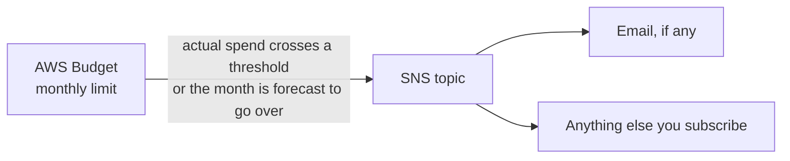

# Budget Guard

A monthly spending limit for the whole AWS account. It alerts; it never stops anything.

AWS updates spend a few times a day, so alerts lag real usage by hours. The forecast alert is the early warning; the percentage alerts confirm.

Deploy once per account. Two budgets per account are free; each one after that is about $0.62 a month.
