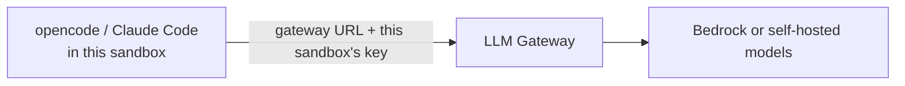
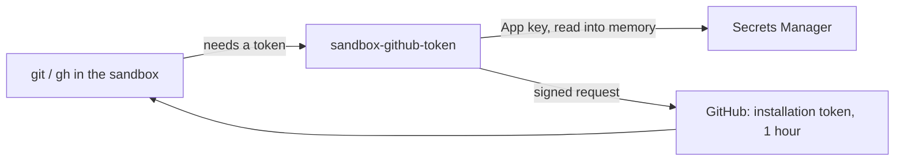

# Developer Sandbox

A cloud VM for one developer, where coding agents can work with broad permissions because the worst they can break is a disposable machine. Add one environment per developer to get one sandbox each.

## What's on it

- `dev` user with passwordless sudo, docker, git, the GitHub CLI (`gh`), tmux and herdr
- mise with the chosen languages
- The chosen coding agents, already configured for the AI Platform when it's connected
- Massdriver tooling: the `mass` CLI, the Massdriver MCP server for agents, and the Massdriver plugin for Claude Code when it's selected
- Your dotfiles, if you gave a repository

Work goes in `/workspace`. It's a separate disk that survives the VM being rebuilt; docker images and build cache live there too. Everything else is rebuilt from scratch on each new release of this bundle.

## Connecting for the first time

You don't need an AWS login. Each sandbox comes with its own key, which can only wake this sandbox and open a session on it.

1. **Install the tools once.** On a Mac:

   ```bash
   brew install awscli
   curl -fsSLo /tmp/smp.zip "https://s3.amazonaws.com/session-manager-downloads/plugin/latest/$([ "$(uname -m)" = arm64 ] && echo mac_arm64 || echo mac)/sessionmanager-bundle.zip"
   unzip -qo /tmp/smp.zip -d /tmp
   sudo /tmp/sessionmanager-bundle/install -i /usr/local/sessionmanagerplugin -b /usr/local/bin/session-manager-plugin
   ```

   On Linux or Windows, install the [AWS CLI](https://docs.aws.amazon.com/cli/latest/userguide/getting-started-install.html) and the [Session Manager plugin](https://docs.aws.amazon.com/systems-manager/latest/userguide/session-manager-working-with-install-plugin.html).

2. **Download the connect script.** Open this sandbox's **Connect to …** resource in Massdriver and click **Connect script**, or from a terminal:

   ```bash
   mass resource download <project>-<environment>-sandbox.access --format sh > sandbox.sh
   ```

3. **Run it.**

   ```bash
   sh sandbox.sh
   ```

   It adds an AWS profile and an SSH host, both named after the sandbox, and makes an SSH key just for it. Nothing else on your machine changes.

4. **Connect.**

   ```bash
   ssh <sandbox-name>
   ```

   If the sandbox is stopped, this starts it first; the first connection after a stop takes about a minute. In VS Code or Cursor, use **Remote-SSH: Connect to Host…** and pick the same name.

Run the script again only if the sandbox is decommissioned and recreated. Rebuilds and stops don't change anything on your side.

Once in, start `herdr` to run several agents side by side, or `opencode` for one.

## AI Platform



When the environment has an LLM Endpoint, the sandbox writes its own key where the gateway picks it up, and points each agent at the gateway with every model it serves. Nothing is copied by hand. Without one, the agents are installed but have no model configured.

Agents start on the gateway's default model. To use another, run `/models` inside opencode, or start it with `opencode -m aiplatform/<model>`. Models added to the gateway later show up after the sandbox is redeployed.

## Massdriver tools

Agents can drive Massdriver through its MCP server, and the `mass` CLI is on the path. Both stay off until the sandbox has a Massdriver API key.

To turn them on, store a service account key in Secrets Manager, in the sandbox's region, named `<sandbox-name>/massdriver-api-key`:

```bash
aws secretsmanager create-secret --region <region> --name <sandbox-name>/massdriver-api-key \
  --secret-string '{"api_key": "<service account key>", "organization_id": "<org slug>"}'
```

Then, in the sandbox, run `sandbox-massdriver-login` and open a new shell. It puts the key in the environment and the `mass` profile, and switches the MCP server on for opencode. Delete the secret and run it again to switch everything off.

## GitHub



When the environment has a **GitHub App** connection, `git clone`, `git push` and `gh` work against the App's organization with no personal token. The sandbox keeps its own copy of the App's key in Secrets Manager, readable only by its role. When git or `gh` needs access, it mints an installation token that lasts an hour, caches it, and mints a new one shortly before it expires. The key itself is never written to disk.

Use HTTPS URLs (`https://github.com/<org>/<repo>`). Repositories outside the App's organization get no token and ask for credentials as usual.

Commits are authored as **Your name for commits** and **Your email for commits**. Use an address on your GitHub account and commits link to your profile; pushes always show the App as the pusher.

## Stopping

The VM stops itself after the chosen idle time (CPU near zero) and at the nightly stop time. `ssh` starts it again. A stopped sandbox costs only its disks.

## Not included yet

Browser access (opencode web).
