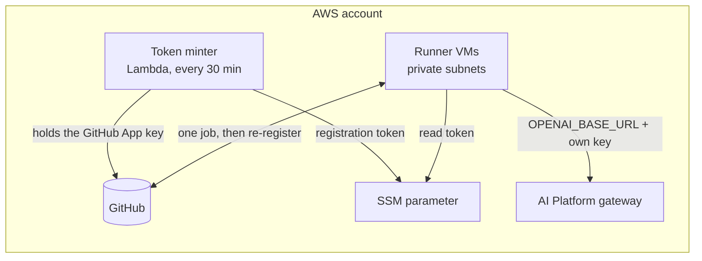

# GitHub Runners

Self-hosted GitHub Actions runners for a whole GitHub organization, on VMs in your VPC's private subnets. Any repository in the organization can run jobs on them with:

```yaml
runs-on: [self-hosted, factory]
```

Jobs on these runners can reach private services, the AI Platform in particular, which GitHub's own runners can't.



## How registration works

The GitHub App's private key never reaches the runner VMs. A small Lambda holds it, and every 30 minutes it:

- mints an organization registration token (valid for an hour) into an SSM parameter the VMs can read;
- removes runners of this bundle that GitHub shows as offline, left behind when a VM was replaced or stopped.

Each VM registers an **ephemeral** runner, takes one job, deregisters, cleans its work directory and registers again. Every job starts with a clean checkout, but docker images and caches stay on the disk to keep builds fast.

## What jobs get

- Labels `self-hosted`, `linux`, `arm64`, `factory`, the runners' name, and any extra labels.
- docker, git, Python 3.13, Node 22 and opencode.
- With an LLM Endpoint connected, `OPENAI_BASE_URL`, `OPENAI_API_KEY` and `OPENAI_MODEL` in every job's environment, using the runners' own gateway key.
- No AWS permissions. Jobs that deploy or push images use their repository's OIDC role, as on GitHub's runners.

## Trust

These runners run code from **every repository in the organization**, including pull requests. Treat organization membership as the trust boundary. Jobs run as an unprivileged user that can't reach the instance metadata service, but they can use docker, and anyone who can run docker on a machine can become root on it. Nothing worth stealing lives on the VMs besides a short-lived registration token and the runners' gateway key.

GitHub's default runner group is open only to private repositories. For public repositories to use these runners, allow them under **Organization settings → Actions → Runner groups → Default**, and remember that anyone can open a pull request on a public repository.

## AI review on pull requests

[`workflows/ai-review.yml`](workflows/ai-review.yml) reviews every pull request with the AI Platform's default model and posts one review comment. Copy it into a repository's `.github/workflows/` to turn it on. It needs runners with an LLM Endpoint connected, and uses only the job's own `GITHUB_TOKEN`.

## Cost

Each runner is a VM billed while it runs, waiting for jobs or not: about $25 a month for Medium, plus its disk. The token minter's Lambda, schedule and secret cost under $1 a month together.
