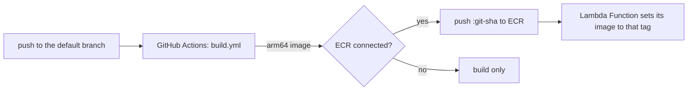

# GitHub Repository

A repository in the connected GitHub organization, created through the GitHub App, with a build pipeline already in it.

## The pipeline

With **Add a starter app** on, the repository starts with a small Python Lambda function, its Dockerfile and `.github/workflows/build.yml`. Every pull request builds the image. Every push to the default branch builds it and, when a container repository is connected, pushes it to ECR tagged with the commit SHA. Images are built for arm64 to match the Lambda Function bundle.

The workflow reads three repository variables, which this bundle sets when a container repository is connected: `AWS_REGION`, `AWS_ROLE_ARN` and `ECR_REPOSITORY_URL`. Without them, it builds and stops. Connecting a container repository later turns pushing on without touching the workflow.

The starter files are written once, when the repository is created, and then belong to the team. Redeploying this bundle never overwrites them, and never replaces a file that already exists.

## AWS access without keys

Pushing uses GitHub's OIDC tokens. This bundle creates a role that only the default branch of this one repository can assume, with the container repository's push policy attached. No AWS keys are stored in GitHub. The environment needs the **GitHub Actions OIDC** bundle's resource as its default; deploy that bundle once per AWS account.

## Visibility

Private repositories are visible to the organization's members and use GitHub Actions minutes from the plan's allowance. Public repositories are visible to everyone and build free.

Branch protection isn't configured. On GitHub's free plan it's only available for public repositories.

## Decommissioning

The repository is archived, not deleted, so the code survives. The name stays taken until the archived repository is deleted or renamed on GitHub.
