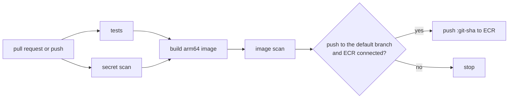

# GitHub Repository

A repository in the connected GitHub organization, created through the GitHub App, with a build pipeline already in it.

## The pipeline

With **Add a starter app** on, the repository starts with a small Python Lambda function, a test for it, its Dockerfile and `.github/workflows/build.yml`. Every pull request and every push to the default branch:

1. runs the tests with pytest,
2. scans the whole git history for committed secrets with gitleaks,
3. builds the image for arm64, to match the Lambda Function bundle,
4. scans the image with Trivy and fails on any critical vulnerability that has a fix.

On the default branch, when a container repository is connected, the image is then pushed to ECR tagged with the commit SHA. Nothing is pushed unless every step passed.

The workflow reads three repository variables, which this bundle sets when a container repository is connected: `AWS_REGION`, `AWS_ROLE_ARN` and `ECR_REPOSITORY_URL`. Without them, it builds and stops. Connecting a container repository later turns pushing on without touching the workflow.

The starter files are written once, when the repository is created, and then belong to the team. Redeploying this bundle never overwrites them, and never replaces a file that already exists.

## The factory workflows

With **Add the factory workflows** on, the repository also gets two workflows and an `agent` label:

- **`agent.yml`:** label an issue `agent`, or comment `/agent` with extra instructions, and a coding agent works on it and opens a pull request.
- **`ai-review.yml`:** every pull request gets one review comment from the AI Platform's default model.

Both run on the Software Factory's runners (`runs-on: [self-hosted, factory]`), which need an LLM Endpoint connected. Without those runners the jobs wait in the queue. Keep the name `agent.yml`: the runners' token service only hands a push token to a workflow with that name. Like the starter app, these files are written once and then belong to the team.

## Release to dev

Set **Release to** to an instance ID, like `todoapp-dev-fn`, and pick groups in **Release permissions**. The repository then gets `.github/workflows/release.yml`. After each successful build on the default branch, it deploys that instance with `image_uri` set to the new image.

It deploys with a Massdriver service account made for this repository, in the groups you picked, so it can only do what those groups allow. Pick a group that can deploy to dev and not to production. The token is stored as the `MASSDRIVER_API_KEY` Actions secret.

This needs a container repository and a Massdriver Service Account credential on the environment. The workflow is written once, like the starter app. Adopted repositories get the service account, secret and variables, but add the workflow themselves.

## AWS access without keys

Pushing uses GitHub's OIDC tokens. This bundle creates a role that only the default branch of this one repository can assume, with the container repository's push policy attached. No AWS keys are stored in GitHub. The environment needs the **GitHub Actions OIDC** bundle's resource as its default; deploy that bundle once per AWS account.

## Visibility

Private repositories are visible to the organization's members and use GitHub Actions minutes from the plan's allowance. Public repositories are visible to everyone and build free.

Branch protection isn't configured. On GitHub's free plan it's only available for public repositories.

## Decommissioning

The repository is archived, not deleted, so the code survives. The name stays taken until the archived repository is deleted or renamed on GitHub.

## Adopting an existing repository

Turn on **Adopt an existing repository** on the first deploy to manage a repository that already exists in the organization, with **Repository name** set to its name. Massdriver takes it over as it is: no files are written (neither the starter app nor the factory workflows), nothing is overwritten, and an archived repository is unarchived. From then on it behaves like one this bundle created, including being archived, not deleted, on decommission.

If the repository already has Actions variables named `AWS_REGION`, `AWS_ROLE_ARN` or `ECR_REPOSITORY_URL`, delete them first; this bundle creates its own.
