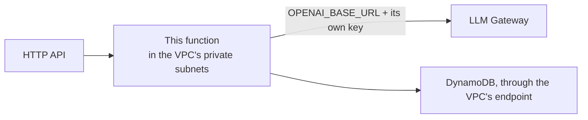

# Lambda Function

A function on arm64 that answers routes on a connected HTTP API, with an optional DynamoDB table and optional access to the AI Platform's models.

## Code

Leave **Container image** empty and a built-in placeholder answers every route with the request it received and the status of its table. That proves the API, the function and the table are wired before any real code exists.

To run real code, push an **arm64** image to ECR and set its URI. The image must implement the Lambda runtime API: start from an AWS base image (`public.ecr.aws/lambda/python`, `nodejs`, …), or add the [Lambda Web Adapter](https://github.com/awslabs/aws-lambda-web-adapter) to an ordinary web server image. Pin by digest or an immutable tag; a moving tag like `latest` isn't picked up until the next deploy anyway.

## Routes

Each entry is `METHOD /path`. `ANY /{proxy+}` plus `ANY /` sends everything to this function. To split an API across functions, give each one specific routes such as `GET /items` and `POST /items/{id}`.

The function receives API Gateway's version 2.0 event and returns `statusCode`, `headers` and `body`.

## Sign-in

With **Require sign-in** on, API Gateway rejects requests to this function's routes unless they carry a valid token from the user pool connected to the API. The function receives the user's claims at `requestContext.authorizer.jwt.claims` (`sub`, `email`, …).

**Sign-in needs a user pool on the API.** If the API has none, the deploy still succeeds but the routes are **public**: the deployment log ends with a warning saying so, and the function's description in AWS starts with `PUBLIC`. Connect a user pool to the API, redeploy the API, then redeploy this function. Deploys don't cascade, so the function stays public until its own redeploy.

## Table

With a DynamoDB table connected, the function gets the table's read-write policy, or read with **Table access**, plus `TABLE_NAME` and `TABLE_PARTITION_KEY` environment variables.

## Runtime

This bundle is also a runtime. An application on it is one `massdriver.yaml`: the DynamoDB tables it needs, as dependencies, and the environment variables that name them, under `app.envs`. The function gets every one of those variables and each extra table's read-write policy. The runtime owns every param: image, routes, memory, sign-in. Applications add none.

## AI Platform

Connect an **LLM Endpoint** and the **VPC**, and the function:

- moves into the VPC's private subnets, because the gateway only accepts traffic from inside the VPC;
- writes its own key where the gateway picks it up, like a sandbox does;
- gets `OPENAI_BASE_URL`, `OPENAI_API_KEY` and `OPENAI_MODEL`, so any OpenAI SDK works unchanged.

Without an LLM Endpoint the function stays outside the VPC and starts faster. Inside the VPC it reaches the internet through the VPC's egress, which has to be on.
