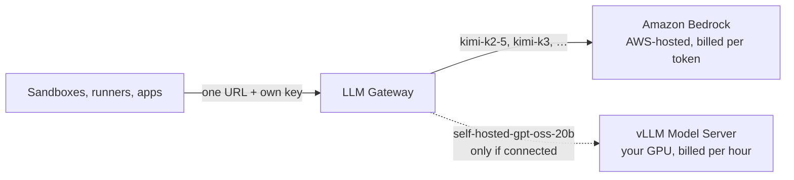
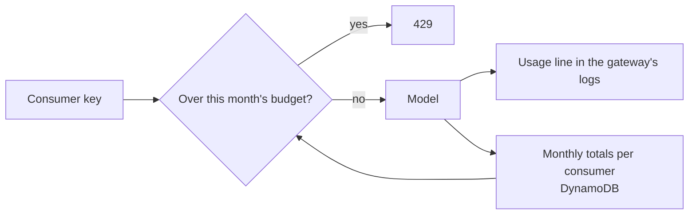

# LLM Gateway

The one address every consumer uses to reach a model. It speaks the OpenAI API, so opencode, Claude Code, LangChain and plain `curl` work against it unchanged.

The gateway runs no model itself. It's a small proxy (LiteLLM) that forwards each request to wherever the requested model lives:

## Who can reach what

- **Consumers** (sandboxes, runners, apps) reach the gateway on port 4000 from anywhere in the VPC, and must present a key.
- **Bedrock** is reachable only through the gateway: its IAM role is the only one granted `bedrock:InvokeModel`.
- **A self-hosted model server** accepts connections only from the gateway's security group.

## Keys

There is no key database. Each consumer writes its own key as a SecureString under the gateway's key prefix (`/<gateway>/keys/<consumer-name>`), and the gateway picks up every key under that path within a minute. Deleting the parameter revokes the key. Requests are attributed to the consumer name.

An admin key lives in Secrets Manager at `<gateway>/master-key`.

## Models

The gateway serves two kinds of model:

- **Bedrock models**, picked in **Bedrock models**. AWS runs them; there's nothing to start or size, and you pay per token. The first one picked is the default.
- **A self-hosted model**, only when a vLLM Model Server is connected to this gateway on the canvas. It's added as `self-hosted-<model>` alongside the Bedrock models, not instead of them. Connecting it is optional.

Consumers see every model in the list and choose per request; in opencode that's `/models`. The list is published on this gateway's **LLM Endpoint** resource, and connected sandboxes pick it up on their next deploy.

## Usage and budgets

Every request writes one JSON line to the gateway's log group with the consumer, model, input and output tokens, and estimated cost. Monthly totals per consumer are kept in a small DynamoDB table the gateway owns.

**Monthly budget per consumer** caps each sandbox, runner or app. Once its estimated Bedrock spend for the calendar month (UTC) reaches the budget, the gateway answers it with `429` and a message saying so until the 1st. **Budget overrides** give specific consumers a different limit; 0 means no limit. Changes apply within a minute, without restarting anything.

Costs are estimated from list prices per million tokens, so they track the bill closely but aren't the bill. The self-hosted model costs nothing per token and never counts toward a budget.

## Instance

A t4g.small running LiteLLM in Docker. Configuration and keys are read from Parameter Store every minute, so model changes apply without replacing the instance.
