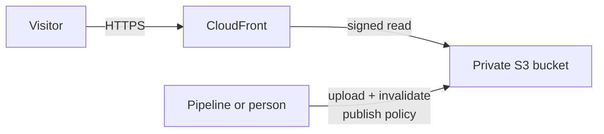

# Static Site

A website with no servers: files live in a private S3 bucket, and CloudFront serves them over HTTPS from edge locations.



The bucket is never public. Only this distribution can read it.

## Publishing

Build the site, upload the output, then invalidate the cache so visitors get the new files:

```bash
aws s3 sync ./dist s3://<bucket> --delete
aws cloudfront create-invalidation --distribution-id <id> --paths '/*'
```

A pipeline gets permission by attaching the site's **publish** policy to its role. Until something is published, the site shows a placeholder page.

## Calling an API

Connect an **HTTP API** and the site gets `/config.json`:

```json
{ "api_url": "https://abc123.execute-api.us-east-1.amazonaws.com" }
```

Fetch it when the app starts instead of building the URL in, and the same build works in every environment. Publishing with `--delete` removes it, so exclude it: `aws s3 sync ./dist s3://<bucket> --delete --exclude config.json`. A redeploy puts it back.

The browser calls the API from the site's origin, so add the site's URL to the API's **Browser origins allowed to call it (CORS)**.

## Single-page apps

With **Single-page app** on, any path that isn't a file returns `index.html`, so routes handled in the browser (`/todos/42`) load the app instead of an error.

## Cost

CloudFront's free tier covers 1 TB and 10 million requests a month. Beyond that it bills per GB and per request. Storage is S3's usual rate; replaced files are kept 7 days for rollback, then deleted.
