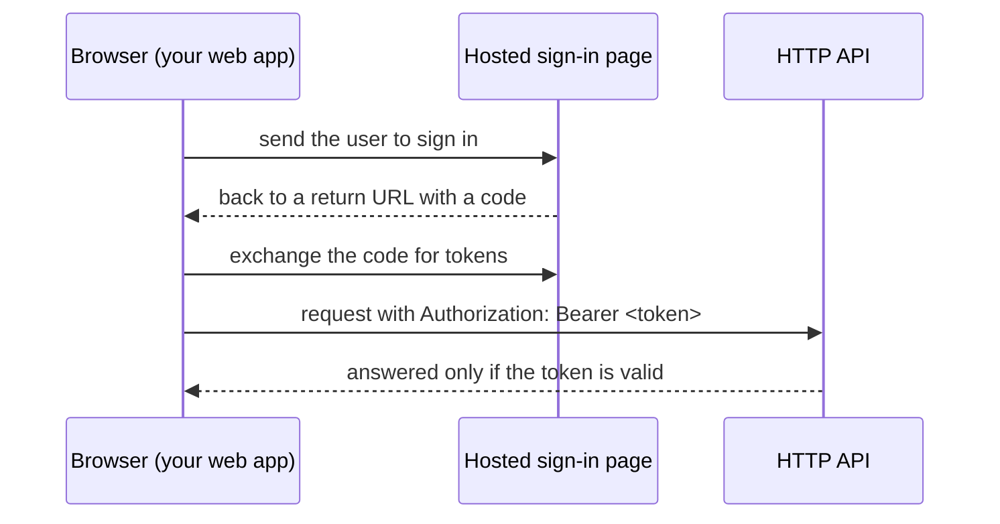

# User Pool

Sign-in for an app. Users sign up and sign in with their email on a hosted page; the app gets tokens back, and APIs connected to this pool accept only valid ones.

## Wiring it up

- **HTTP API:** connect this pool, and functions with **Require sign-in** reject requests without a valid token.
- **Web app:** use the pool's **Hosted Sign-in Domain** and **App Client ID** with any OpenID Connect library, for example `oidc-client-ts` or AWS Amplify's auth package. The client has no secret and uses the authorization code flow with PKCE, which is the one meant for browsers.
- **Return URLs** must list every page that receives users back, exactly, e.g. the static site's URL with its trailing slash.

## Accounts

Email is the username and is verified on sign-up. Passwords need 12 characters with upper and lower case and a number. Forgotten passwords are reset by email.

Cognito's Lite tier is free for the first 10,000 monthly active users. AWS sends verification and reset emails from its own address, limited to a few dozen a day, which is enough for development but not a launch.
