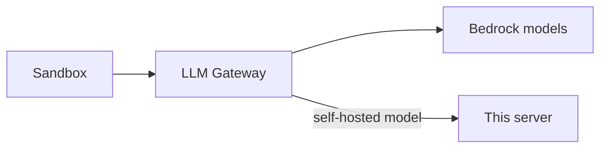

# vLLM Model Server

An open-weight model on a GPU you own, served by vLLM with an OpenAI-compatible API. It's optional: the LLM Gateway works with Bedrock alone, and this adds one more model to it.

Connect it to the gateway on the canvas. Nothing else talks to it directly, and nothing uses it until someone picks `self-hosted-<model>`.

## When to run one

Bedrock is usually cheaper and its models are stronger than anything that fits on one GPU. Run your own when you need the weights and inference on machines you control, a model Bedrock doesn't offer, or steady all-day use where an hourly GPU beats per-token pricing.

## Access

The security group has no ingress of its own. The gateway adds a rule that admits only the gateway, and the server also requires an API key (in Secrets Manager at `<server>/api-key`) that only the gateway reads.

## Cost controls

- **Idle stop** stops the instance when its CPU has stayed below 10% for the chosen time.
- **Nightly stop** stops it at a fixed time in your time zone, as a backstop.

A stopped server costs only its disk (~$10/month). Start it from the EC2 console or the runbook; the model reloads from local disk in a few minutes.

## Before you deploy

The account needs "Running On-Demand G and VT instances" quota of at least 4 vCPUs in the VPC's region. The deploy stops with a clear message if it doesn't. Request it under **Service Quotas → Amazon EC2**; approval can take a day or more on new accounts.

## Models

| Model | Needs |
|---|---|
| gpt-oss-20b | 24 GB GPU (g6.xlarge or g5.xlarge) |
| Qwen3 Coder 30B (FP8) | 48 GB GPU (g6e.xlarge) |

Weights download from Hugging Face on first boot and stay on the instance's disk.
